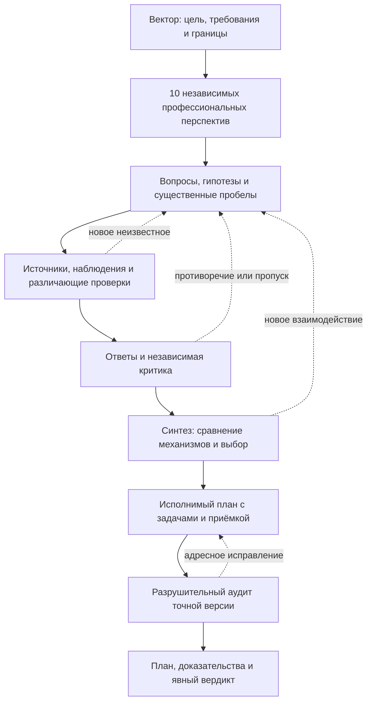

# Question Space

**4.3.0-rc3** — кандидат. Область подтверждённых проверок указана в [статусе проверки](#статус-проверки).

Question Space помогает Codex превратить сложную цель или готовый банк вопросов в самодостаточный машинный план. От каждого существенного требования можно пройти через исследование и выбор решения к задачам, входам и конечной проверке. Если основание изменилось или работа прервалась, сохранённые связи показывают, какой вывод пересмотреть и с какого действия продолжить.

## Основная идея

Сложная задача часто начинается с предложенного решения: «добавим модель», «перепишем компонент», «возьмём эту библиотеку». При этом ещё неизвестно, нужен ли именно этот механизм, какие условия делают его полезным и что помешает получить конечный результат. Question Space сначала превращает эти неизвестные в проверяемые вопросы, затем организует исследование, сравнение решений и построение плана.

Рабочая единица метода — **существенный вопрос**. Его ответ должен иметь возможность изменить решение, требование к проверке или оценку достижимости цели. Вопрос связывается с источником и способом различить возможные ответы. Например, «какую библиотеку выбрать?» становится предметным вопросом после уточнения: «какая из доступных реализаций сохраняет нужное свойство при частичном отказе и каким опытом мы это проверим?».

Метод развивает две линии рассуждения одновременно. Первая выясняет, что происходит сейчас, откуда возникают ограничения и при каких условиях задача провалится. Вторая идёт от желаемого результата к необходимым способностям и ищет разные способы их получить. Синтез соединяет эти линии в конкретный механизм. Планировщик превращает его в исполнимые действия, а независимый аудитор ищет, где вся конструкция всё ещё может оказаться несостоятельной.



Схема показывает движение знания. Операторы проекции, дивергенции, реверса и индульгенции работают в соответствующих местах этого процесса; их обязанности раскрыты ниже. Повторная стрелка означает проверку затронутой части с сохранением принятой работы. Она сама по себе не запускает всё исследование заново.

Результат обычного запуска — **обоснованный исполнимый план и проверяемые основания его решений**. Реализация этого плана, внедрение или фактический полезный эффект требуют своего выполнения и полномочий. Скилл сохраняет различие между «механизм определён», «проверка проведена» и «результат реально получен».

### Как читать обозначения

| Обозначение | Смысл |
| --- | --- |
| **G / NOT_G / R** | Цель; существенные способы не достичь её или получить ложный успех; обязательные требования. |
| **Q** | Вопрос, от ответа на который зависит решение или проверка. |
| **H** | Гипотеза: возможное объяснение или предпосылка, которая ещё требует проверки. |
| **E** | Свидетельство с источником, процедурой, наблюдаемым результатом и областью применимости. |
| **D** | Решение с основаниями, альтернативами, возражениями и условиями пересмотра. |
| **S / T / C** | Этап плана; конкретная задача; конечный критерий её приёмки. |

Например: **R → Q → E → D → T → C** читается так: требование породило вопрос; проверка дала свидетельство; на его основании принято решение; задача реализует решение; критерий проверяет нужное поведение. От критерия можно пройти назад и выяснить, какую часть исходной цели он подтверждает.

### Содержание

- [Начало работы и режимы FAST / DETAILED](#начало-работы)
- [Как возникают и развиваются вопросы](#как-возникают-и-развиваются-вопросы)
- [Роли, независимость и советники](#роли-и-рабочий-контекст)
- [Шесть фаз работы](#шесть-фаз-и-методы)
- [Шесть операторов: вектор, проекция, дивергенция, реверс, индульгенция и синтез](#как-работают-шесть-операторов)
- [Двойной айсберг](#двойной-айсберг-текущее-и-желаемое)
- [Четырнадцать приёмов мышления](#четырнадцать-приёмов-мышления)
- [Свидетельства и независимая проверка](#свидетельства-причинность-и-независимая-проверка)
- [Графы знаний, решений и связанных аспектов](#восемь-обязанностей-графа)
- [Сквозной пример и команды](#пример-прохождения)
- [Аудит, итоговый план и его передача](#приёмка-плана-и-передача)
- [Остановка и возобновление](#остановка-и-возобновление)
- [Публикация, установка и откат](#публикация-установка-и-откат)
- [Статус проверки](#статус-проверки)

## Начало работы

В Codex вызовите `$question-space`. Если нужен только CLI, запускайте команды из корня копии скилла с Python 3 и зависимостями из [requirements.txt](requirements.txt). Храните рабочий каталог запусков отдельно от исходников скилла.

Передайте цель, получателя результата, признаки успеха, ограничения, материалы и границы полномочий. Укажите внешние действия, которые требуют отдельного разрешения. Если банк уже есть, передайте исходник вместе с нормализованным представлением и происхождением. Координатор уточняет решения, принадлежащие владельцу, и организует исследование открытых вопросов о механизме, архитектуре и проверках.

| Вход | Подготовка |
| --- | --- |
| `GOAL_TO_PLAN` | Оператор VECTOR готовит Вектор с целью G, сценариями ложного успеха NOT_G, проверяемыми требованиями R и полномочиями. Владелец явно утверждает точную ревизию. Затем десять перспектив независимо формулируют вопросы. Расширение и нормализация сохраняют происхождение. |
| `BANK_TO_PLAN / APPROVED_RUN_IMPORT` | Импорт связывает точные исходные байты банка, ранее утверждённый Вектор, одобрение и его основание. Локальная проверка устанавливает применимость к текущим G/R и полномочиям. |
| `BANK_TO_PLAN / EXTERNAL_READY_BANK` | Исходный и нормализованный банк связываются точными байтами. Оформляется локальный Вектор с применимыми полномочиями. Пробелы сохраняются как результаты проверки применимости. |

Новый GOAL snapshot фиксирует `MATERIAL_UNKNOWNS_V1`. Каждая из десяти перспектив независимо фиксирует все материальные неизвестные своей области. Пустой список требует проверяемого основания, а десять пустых списков блокируют допуск. Ранее созданные GOAL snapshots без поля политики сохраняют контракт с десятью вопросами на перспективу. [Первичные вопросы](references/preparation.md#prep-2--десять-перспектив-и-первичные-вопросы)

Банк допускается один раз после проверки Вектора, различимости перспектив, покрытия R и существенных NOT_G, альтернатив, общих недоказанных предпосылок, взаимодействий, исследуемости вопросов, связи с изменяемыми решениями и достаточности исследования центрального механизма. Готовый банк проходит этот допуск с сохранением исходных вопросов. Изменение утверждённых G/R, полномочий или допущенного банка требует нового запуска. [Подготовка и варианты входа](references/preparation.md) · [Инварианты](references/invariants.md)

### FAST и DETAILED

До содержательной работы координатор фиксирует положительное целое `m`, сопоставимую опись и один регламент исследования. При отсутствии явного выбора используется DETAILED. FAST исследует `m` канонических Q, DETAILED — `2m`. В обоих режимах сохраняются 18 штатных ролей, стадии, методы, глубина на вопрос, инструменты, правила свидетельств, рецензирования и независимого аудита. Сопоставимость проверяется отдельно для GOAL и BANK. Пара GOAL требует одинаковой политики первичных вопросов. При конфликте между качеством и скоростью приоритет у качества.

- **Опись и маршрутизация.** У Q есть источник, область, изменяемое решение и различающий путь проверки. Приоритет учитывает риск для цели, влияние на решение и возможность проверки. Алиасы объединяются по подтверждённой эквивалентности, происхождение каждого сохраняется. У Q один основной автор, остальные роли могут провести собственную полноценную работу по тому же Q как `support`.
- **Начало и закрытие.** Резерв и ACK требуют дальнейшей сверки. Фактическое начало подтверждается наблюдением о содержательной работе по конкретному Q. Закрытие требует принятого ответа или первичного результата и независимого review его точных байтов, контекста и глубины. Незавершённое начало, неизвестный старт, отмена до старта и повторная попытка сохраняются раздельно. Повтор и `support` дают ноль дополнительных Q.
- **Пробелы и новые Q.** Каждый исходный Q сохраняет запись в текущем `SOURCE_OUTCOMES`. Для неизученного Q это адресный `OPEN / UNKNOWN` с основанием пробела. Исследованный `OPEN` имеет принятый ответ с оставшейся проверкой. Новый Q регистрируется до работы с родительским источником, наблюдением, изменяемым D и различающей проверкой. Скрытая содержательная работа блокирует подтверждение объёма.
- **Сопоставление.** Сверяйте точные начатые и закрытые Q и исходы всех исходных вопросов. Нечётный обязательный охват или нехватка сопоставимых вопросов дают явное ограничение. Сохраняйте весь исходный банк и фактический объём без округления и добора вопросов. `question-compare` принимает сначала идентификатор FAST, затем DETAILED того же входного режима. Его результат относится к сопоставимости счёта.

[Журнал и бюджет Q](references/phases/01-intake.md#бюджет-исследования-вопросов) · [Исходы вопросов](references/phases/02-answers.md) · [Поля журнала](schemas/question-ledger.yaml)

## Как возникают и развиваются вопросы

В режиме GOAL десять перспектив сначала работают независимо. Каждая рассматривает цель со своей профессиональной стороны и фиксирует существенные неизвестные, наблюдения, предположения и возможные препятствия. Это позволяет увидеть расхождение постановок до того, как участники согласились с первым убедительным объяснением.

После фиксации этих позиций проекция проверяет возможные провалы и функциональные пробелы, а дивергенция — общие скрытые предпосылки, противоречия между областями и альтернативные постановки. Координатор нормализует полученное пространство: объединяет только подтверждённые эквиваленты, сохраняет исходные формулировки и происхождение, проверяет покрытие требований. Так получается один допускаемый банк вопросов.

Во время исследования новые вопросы могут возникать из ответа, результата опыта, возражения, связи между компонентами или совета. Например:

1. Исходный Q: «Можно ли проверить целостность по списку файлов?»
2. Проверка показывает: список совпадает, но один файл содержит другие байты.
3. Производный Q: «Как связать решение о готовности с содержимым файлов?»
4. Рецензент замечает: после проверки файл ещё может измениться.
5. Следующий Q: «Как обеспечить, чтобы потребитель получил именно проверенную версию?»

Каждый переход должен добавлять новое различие, способное изменить решение. Перед включением нового Q проверяются пять вещей: конкретное неизвестное; влияние на решение; конечный путь проверки; отсутствие эквивалентного уже принятого вопроса; происхождение и стоимость работы. Повтор известного вопроса или другая формулировка того же неизвестного сохраняются как связь, а не выдаются за новое открытие.

В режиме BANK исходные вопросы сохраняются. Подготовка проверяет применимость переданного банка и фиксирует пробелы. Она не переписывает его незаметно. Существенные новые неизвестные в дальнейшей работе проходят отдельную регистрацию по действующему регламенту и бюджету.

Глубина исследования определяется тем, какие важные предпосылки проверены и какие решения изменены. Приоритет получает вопрос, способный изменить центральный механизм, устранить препятствие цели, открыть полезную альтернативу или существенно изменить стоимость результата. Если новый переход не даёт нового различающего исследования, расширение этой ветви прекращается. Неисследованное остаётся видимым с причиной и влиянием на итоговый вердикт.

## Роли и рабочий контекст

Полное прохождение требует **18 отдельных агентов**. Координатор выбирает десять профессиональных перспектив под Вектор. Каждая фиксирует собственную позицию до знакомства с банком и результатами других ролей, затем исследует назначенные Q, сохраняет собственный результат и рецензирует другие перспективы. Шесть отдельных операторов ведут методологические переходы. Планировщик переводит принятые решения в стадии, задачи и критерии. Финальный аудитор независимо проверяет точный замороженный комплект. Координатор назначает агентов и принимает предметные результаты. CLI проверяет структуру и переходы. В среде с одним агентом результат получает `SINGLE_AGENT_ANALYSIS / SELF_REVIEW_ONLY`, итоговый вердикт ограничен `REPAIR_REQUIRED` или `BLOCKED`. [Перспективы](references/roles/perspectives.md) · [Маршрутизация](references/routing.md) · [Планировщик](references/roles/planner.md) · [Аудитор](references/roles/auditor.md)

Слепой пакет содержит задачу, допустимый Вектор, собственный профиль и явно выбранные материалы. Координатор сохраняет выданные инструкции по путям и хешам, отдельно фиксирует фактически прочитанные входы и автоматически переданный контекст. Свежий контекст, точный состав пакета и журнал чтения подтверждают соблюдение протокола слепой работы. Ограничения доступа на уровне ОС требуют отдельной проверки. После принятия позиции рабочий пакет добавляет назначенные Q, D, E и разрешённые зависимости. Канонические результаты и состояние хранятся в YAML, первичные материалы сохраняют исходные байты и хеши. [Контекст и хранение](references/state-and-storage.md) · [Вход и назначения](SKILL.md)

### Ревизии рабочего пакета

До записи `claim-effect` координатор может расширить пакет ожидающего рабочего назначения через `context --expand RESULT_ID`. Укажите текущий принятый источник, уже связанный с назначением, и новый путь вывода. Новая ревизия добавляет полные материалы к уже раскрытым, проверяет актуальность и разрешения всего набора, сохраняет байты предшественника и связывает оба хеша. Слепой `FRAMING` и собственный пакет `ADVISER` выдаются в пределах исходного назначения без расширения.

В примере `qs_packet_v2` и `qs_packet_copy` указывают новые внешние пути, а `qs_prior_packet_sha256` получен при прежней выдаче того же обычного рабочего назначения.

```sh
python3 -B scripts/qs.py context --root "$qs_workspace" --run-id "$qs_run" \
  --assignment "$qs_assignment" --expand "$qs_linked_result" --output "$qs_packet_v2"
python3 -B scripts/qs.py context --root "$qs_workspace" --run-id "$qs_run" \
  --assignment "$qs_assignment" --historical --packet-sha256 "$qs_prior_packet_sha256" \
  --output "$qs_packet_copy"
```

При отправке сверяйте байты текущего пакета с хешем в свежем разрешении `SEND_ONCE`. Новый `commit` расширенного назначения связывает текущий пакет через `context_packet_sha256`. При проверке принятого результата используется записанный в нём хеш. Историческое чтение копирует байты указанной ревизии. При `DISPATCH_UNKNOWN` или `HOLD_RECONCILE` отправка удерживается до сверки с наблюдаемым состоянием у получателя. [Команды](references/data-contract.md) · [Ревизии пакета](references/state-and-storage.md#адресный-context) · [Контракт журнала](schemas/command-admission.yaml)

### Советник

**ADVISER** — дополнительная роль, при одном назначении это свежий девятнадцатый агент. В обычных FAST и DETAILED советнику в PREP или CORE выдают адрес пробела, альтернативы, возражения или вопроса и минимально достаточную выборку разрешённого контекста. Маршрутизация использует адреса, связи и хеши. Содержательная работа советника привязывается как `support` к уже исследуемому Q. Вклад связывает точный пакет, источник, область и наблюдаемое подтверждение доставки.

Получатель фиксирует `ACCEPTED / QUALIFIED / REJECTED / PENDING` с обоснованием. Перспектива оформляет своё решение в `REVIEW` со своим принятым слепым `FRAMING`. Оператор, планировщик или аудитор записывает решение в своём `EVIDENCE`, связывая точные назначение, попытку, вклад и хеш контекста. Независимая перспектива получает полные байты этого решения и вклада в разрешённом рабочем контексте и рецензирует точное решение. Отказ по утратившему актуальность контексту связывается с его сохранённым хешем.

Если новая ревизия плана использует принятое или квалифицированное замечание, планировщик указывает его ID и хеш, ID и хеш рецензии решения, хеш контекста и область применения в `advice_consumption`. Независимая перспектива проверяет точный этап с полным доступом к замечанию и рецензии, фиксирует, что изменилось, и сверяет условия квалификации. Координатор выбирает проверенную ревизию. Существенный вклад без актуального рассмотрения или с утратившим силу основанием удерживает затронутый переход. Если замечание породило новый исследуемый Q, его регистрируют по общим правилам. Все 18 штатных ролей сохраняют обязанности по исследованию, принятию свидетельств и аудиту. [Контракт советника](references/roles/operators.md#советники-prep-и-core)

## Шесть фаз и методы

| Фаза | Результат |
| --- | --- |
| [1. Intake](references/phases/01-intake.md) | Сверить snapshot, Вектор, допуск и позиции перспектив. Назначить вопросы с сохранением всех исходных ID и границ. |
| [2. Ответы](references/phases/02-answers.md) | Установить фактическое состояние, описать механизм, условия, альтернативы, цену и проверку. Сохранить ответы, свидетельства, неизвестные и происхождение. |
| [3. Критика](references/phases/03-critique.md) | Проверить собственные выводы и выводы коллег. Для существенных расхождений найти условия и наблюдение, способное различить позиции. Критическое D требует независимых предметной и системной проверок. |
| [4. Синтез](references/phases/04-synthesis.md) | По заранее зафиксированному протоколу сравнить содержательно разные A/B/C и обосновать выбранный механизм. Сохранить сильнейшие возражения, основания отсева и условия пересмотра. |
| [5. План](references/phases/05-plan.md) | Связать выбранный механизм с корневым S-000, стадиями S, задачами T и критериями C. Определить входы, выходы, команды, ресурсы, порядок, полномочия, условия остановки и возобновления. |
| [6. Аудит](references/phases/06-audit.md) | Найти контрпримеры достижению G, проверить центральный механизм, состав и версии пакета, последнее исправление и честность итогового статуса. |

Фазы задают порядок принятия результатов. Операторы задают способы работы с ними. Поэтому реверс или проекция могут понадобиться и при подготовке, и после обнаружения нового взаимодействия в синтезе. Их возвращение к конкретному вопросу сохраняет результаты, которых новое обстоятельство не касается.

## Как работают шесть операторов

### 1. Вектор — определить результат и границы

**Главный вопрос: «Какой результат действительно нужен и что нельзя выдать за его достижение?»**

VECTOR переводит запрос владельца в цель G, обязательные требования R, существенные сценарии NOT_G, границы работы и полномочия. Например, «перенести архив» недостаточно: нужно определить, кто будет его читать, какие данные должны сохраниться и допустима ли видимость частично записанного результата.

Вектор задаёт условия выбора архитектуры. Предложенный владельцем метод может остаться гипотезой, если владелец не закрепил его как обязательное требование. Это позволяет исследованию заменить первоначальный механизм, сохранив нужный результат. Точная ревизия Вектора утверждается до основного исследования; координатор не меняет цель незаметно по мере появления удобных решений.

**Выход:** согласованные G/NOT_G/R и полномочия, по которым можно оценить любой последующий вариант. [Контракт VECTOR](references/roles/operators/vector.md)

### 2. Проекция — заранее разобрать провал и ложный успех

**Главный вопрос: «При каких условиях выбранный путь не приведёт к цели, даже если отдельные проверки пройдут?»**

PROJECTION рассматривает исходное состояние и конкретные пути к NOT_G. Для каждого существенного сценария нужны условия возникновения, последовательность событий, предполагаемый механизм, ранний признак и действие, которое ещё успеет изменить исход. Причина, симптом, обнаружение и восстановление рассматриваются раздельно.

Например: каталог назначения уже существует, но часть файлов ещё не записана. Если потребитель считает наличие каталога признаком готовности, он может прочитать неполный архив. Поздняя запись ошибки в журнал поможет расследованию, но не устранит уже произошедшее чтение. Поэтому вопрос становится таким: «Как не допустить передачи непроверенной версии потребителю?»

Оператор различает необходимое условие успеха, достаточное условие провала и пока лишь гипотезу о риске. Из устранения одного известного провала не следует достижение всей цели: **отсутствие F не доказывает G**. Для предлагаемой защиты нужны и отрицательный контроль, воспроизводящий отказ, и положительный, подтверждающий полезное поведение.

**Выход:** карта существенных провалов, различающие вопросы и проверки, способы устранить причину, разорвать опасный переход или обойти его. После изменения архитектуры повторно рассматриваются затронутые сценарии. [Контракт PROJECTION](references/roles/operators/projection.md)

### 3. Дивергенция — сохранить разногласия и найти упущенные способы решения

**Главный вопрос: «Какие другие объяснения или механизмы возможны — в том числе за пределами общего предположения участников?»**

DIVERGENCE работает с уже зафиксированными независимыми позициями. Она сохраняет сильные несовместимые гипотезы и возражения меньшинства, ищет общую скрытую предпосылку, иной масштаб, объект, временной порядок или третий механизм. Единодушие нескольких агентов само по себе не превращает предположение в факт.

Разногласие сначала уточняется. Иногда стороны говорят о разных версиях данных или условиях, и оба вывода верны в своих границах. Если выводы действительно несовместимы, нужно определить наблюдение, при котором они дадут разные предсказания. Голосование не заменяет такую проверку.

Например, один участник предлагает проверять архив после копирования, другой — во время записи. Дивергенция может выявить их общую предпосылку: потребитель читает тот же изменяемый каталог. Тогда появляется третий вариант — готовить отдельную неизменяемую версию и публиковать её только после проверки. Это новая гипотеза для проверки, а не автоматически лучший ответ.

**Выход:** различимые альтернативы, условия их применимости, сильнейшие возражения и проверки, способные изменить выбор. [Контракт DIVERGENCE](references/roles/operators/divergence.md)

### 4. Реверс — три способа изменить направление рассуждения

**Главный вопрос: «Что откроется, если идти от результата назад, перевернуть постановку или построить путь вокруг причины провала?»**

REVERSE выполняет три разных прохода. Один обратный список задач не заменяет остальные.

| Проход | Что делает оператор | Пример с передачей архива |
| --- | --- | --- |
| **От G назад, затем снова вперёд** | От нужного результата выводит необходимые способности, состояния и входы. Затем проверяет, кто производит каждый вход и достаточно ли переходов для достижения G. | Потребитель читает полную проверенную версию ← опубликована именно проверенная версия ← содержимое связано с результатом проверки ← есть полный доступный источник и процедура проверки. Затем проверяется весь прямой путь. |
| **Инверсия постановки или порядка** | Меняет исследуемое допущение: объект на действие или результат, подтверждение на попытку опровергнуть, улучшение компонента на проверку его необходимости. | Вместо «как ускорить повторное копирование?» спросить «обязательна ли повторная запись всех байтов для получения самостоятельной полной версии?». Ответ зависит от требований к переносу и доступных средств хранения. |
| **Реверс подтверждённого NOT_G** | Берёт конкретный механизм провала и ищет устранение причины, разрыв перехода или обход. Получившийся альтернативный путь снова проверяет до G. | Если испытание подтвердило чтение незавершённой версии, исследовать отдельное место подготовки и переключение потребителя после проверки. Проверить также сбой самого переключения. |

Каждый проход должен дать предметное изменение: новый вопрос, другой механизм, найденную зависимость, снятую ненужную работу или проверяемое опровержение. Фразы «посмотрим наоборот» для результата недостаточно.

Обратное рассуждение устанавливает, что **понадобилось бы**, но ещё не доказывает, что это существует или может быть получено вовремя. Поэтому обязательна проверка вперёд: доступные входы → реальные переходы → нужный результат. Знание будущего исхода нельзя незаметно превратить во вход прошлого решения. Зависимость выбранного механизма также не становится неизменяемым требованием владельца: другой механизм может обходиться без неё.

**Выход:** необходимые способности, альтернативные конструкции, новые вопросы и проверки прямой достижимости. [Контракт REVERSE](references/roles/operators/reverse.md)

### 5. Индульгенция — разрешить проверку рабочей гипотезы

**Главный вопрос: «Какой небольшой разрешённый опыт действительно различит варианты и стоит ли полученная информация его цены?»**

INDULGENCE даёт рабочему предположению ограниченную возможность проявить себя в опыте. Неподтверждённую гипотезу можно временно принять для построения проверяемой модели или прототипа. Обязательные требования, полномочия и критерии успеха при этом сохраняются.

До опыта фиксируются гипотеза и изменяемое решение, входные данные и версии, контроль, процедура, положительный, отрицательный и неопределённый исходы, бюджет, условия ранней остановки, восстановление и независимая проверка результата. Заранее рассматривается, как сам опыт может дать ложное подтверждение или оказаться нечувствительным к дефекту.

Например, на временной копии можно намеренно оборвать запись файла и проверить, откажется ли процедура публиковать архив. Полная корректная копия должна пройти тот же путь. Если обе копии отклоняются из-за отсутствующей зависимости, опыт не проверил нужную защиту. Если опыт недоступен, сохраняются точный проект проверки и статус `NOT_RUN`, а наблюдаемый результат не выдумывается.

Ценность опыта определяется возможностью изменить решение, стоимостью ошибки, затратами и вытесненной работой. Он сравнивается также с вариантом **«не проводить сейчас»**: если ни один доступный исход не изменит ближайшее решение, опыт можно отложить. При отсутствии обоснованных вероятностей используются явные сценарии и качественное сравнение последствий. После неудачной гипотезы должны оставаться пригодные сведения о её границах. Восстановление файлов не стирает факт уже полученного знания, если он влияет на независимость последующих проверок.

**Выход:** ограниченный эксперимент и его свидетельства либо конкретный ещё не выполненный маршрут проверки с причиной. [Контракт INDULGENCE](references/roles/operators/indulgence.md)

### 6. Синтез — выбрать целостный механизм

**Главный вопрос: «Какая конструкция в целом лучше ведёт к исходной цели при имеющихся данных, ресурсах и ограничениях?»**

SYNTHESIS получает ответы, свидетельства, альтернативы, результаты опытов и сильнейшую критику. Его задача — определить работающий совместный механизм, а не включить в него все понравившиеся идеи. Для независимого взгляда синтезатору по возможности дают свежий контекст с адресными материалами, без истории убеждения в прежнем победителе.

Сравнение организовано по трём направлениям:

| Направление | Что требуется построить |
| --- | --- |
| **A — существенно улучшить существующее** | Сохранить доказанно полезные части и устранить ограничения текущего подхода. |
| **B — заменить центральный механизм** | Проверить конструкцию, которая снимает ключевую ограничивающую предпосылку другим способом работы. |
| **C — спроектировать от цели** | Вывести решение из G, необходимых способностей и ресурсов, не делая нынешнюю архитектуру обязательной отправной точкой. |

До результатов закрепляются общие входы, условия, критерии, их приоритеты, сопоставимый бюджет и порядок учёта попыток. **Сначала исключаются варианты, нарушающие обязательные R.** Скорость или низкая стоимость не компенсируют такое нарушение. Допустимые варианты сравниваются по достижению G, охвату полезных возможностей, качеству, предпосылкам, стоимости подготовки и исполнения, времени до полезного результата, сложности, совместимости и проверяемости. Результаты учитывают все предусмотренные попытки, а приоритеты не меняются после знакомства с победителем. Три настройки одного алгоритма не считаются тремя содержательно разными архитектурами. Если обоснованы только два варианта, сохраняются фактические результаты поиска и причины отсутствия третьего.

Выиграть может A, B, C или обоснованное сочетание. Для сочетания проверяются новые взаимодействия: работоспособность компонентов по отдельности не доказывает работоспособность сборки. У отвергнутой альтернативы сохраняются причина и условие, при котором её стоит пересмотреть. Самая сложная конструкция не получает преимущества за сложность; простота полезна, когда сохраняет необходимые способности.

Выбор завершается проверкой в обе стороны: **доступные входы → механизм → G** и **G → необходимые способности → входы и проверки**. Архитектурный граф связывает функции, производителей, данные, контракты, потребителей и будущие задачи. Существующие, планируемые и внешние компоненты обозначаются раздельно.

Если центральное предположение ещё не разрешено, синтез должен выделить конечную раннюю проверку и обозначить `RESEARCH_REQUIRED`. Если выбранный механизм определён, планировщик получает достаточно конкретную конструкцию для задач и приёмки. Это обоснованный выбор среди исследованных альтернатив; математическая оптимальность среди всех мыслимых решений не заявляется.

**Выход:** выбранная архитектура, сравнение альтернатив, основания и условия пересмотра, точный путь к G и входы для планировщика. [Контракт SYNTHESIS](references/roles/operators/synthesis.md) · [Протокол A/B/C](references/contracts-v4.1.md)

## Двойной айсберг: текущее и желаемое

«Айсберг» обозначает скрытые под кратким описанием задачи причины, допущения и зависимости. Две карты удерживают разные стороны одного утверждённого Вектора:

| Карта | Что видно на поверхности | Что раскрывается в исследовании |
| --- | --- | --- |
| **CURRENT_REALITY — текущая реальность** | Наблюдаемое состояние, симптом, ограничение или имеющийся результат. | Подтверждённые факты, конкурирующие объяснения, условия отказа, общие предпосылки, ещё не проверенные причины. Основной оператор — PROJECTION. |
| **DESIRED_REALITY — желаемая реальность** | Цель и признаки нужного результата. | Необходимые способности, доступность входов, достаточность переходов, альтернативные механизмы, ресурсы и конечные проверки. Основной оператор — REVERSE. |

Для новой системы в первой карте может не быть наблюдаемого отказа. Тогда записываются факты исходной ситуации и гипотезы, а сбой не придумывается. Во второй карте нужная способность также не выдаётся за уже реализованную.

Синтез соединяет карты: выбранный путь должен учитывать реальные условия и обеспечивать нужные способности. Критик проверяет, не пропущен ли более сильный обход ограничения. Из обнаруженного разрыва возникает Q, если он может изменить решение и для него существует различающая проверка.

Карты являются представлениями зарегистрированных G/R/Q/H/E/D и ссылаются на точные действующие ревизии. Их не ведут как две независимые версии истины. Общая гипотеза нескольких перспектив сохраняет первичные позиции и остаётся гипотезой до проверки. Заполненная карта не доказывает исчерпывающего знания всех возможных причин или решений. [Правила двойного айсберга](references/double-iceberg.md)

## Четырнадцать приёмов мышления

Основу работы составляют анализ — разделить задачу, индукция — заметить закономерность в наблюдениях, дедукция — вывести проверяемое следствие, и синтез — собрать целостный механизм. Следующие приёмы помогают выбирать полезное направление рассуждения внутри ролей и операторов.

| Приём | Когда полезен и какой результат должен дать |
| --- | --- |
| **1. Абдукция** | При неожиданном наблюдении построить несколько возможных объяснений и найти проверку, которая их различит. Правдоподобное объяснение остаётся гипотезой. |
| **2. Рассуждение от цели назад** | Вывести необходимые способности и входы, затем проверить прямую достижимость. Помогает обнаружить недостающего производителя или невозможный переход. |
| **3. Морфологический анализ** | Выделить определяющие параметры решения и содержательно разные совместимые сочетания. Не требует полного перебора всех комбинаций. |
| **4. Инверсия** | Изменить предпосылку, порядок, объект или критерий рассмотрения и получить проверяемую альтернативу. |
| **5. Контрфактическое рассуждение** | Спросить, что изменилось бы при другом условии. Явно отделить вывод внутри модели от реально наблюдавшегося события. |
| **6. Необходимость и достаточность** | Проверить, без чего G недостижима, что лишь помогает и какая совокупность условий действительно достаточна. Найти возможный обход. |
| **7. Концептуальное смешение и аналогия** | Перенести полезную связь из другой области; отдельно проверить совместимость условий. Сходство описаний не подтверждает переносимость механизма. |
| **8. Причинный анализ** | Связать воздействие, временной порядок и механизм; проверить конкурирующую причину и, когда доступно, результат вмешательства. |
| **9. Вычитательное проектирование** | Удалить, объединить или переиспользовать часть конструкции с проверкой сохранения G. Сохранить сложность, если она обеспечивает необходимую способность. |
| **10. Байесовское обновление** | Пересмотреть уверенность после нового свидетельства. Числовые вероятности использовать при обоснованных исходных величинах; иначе описать обновление качественно. |
| **11. Эффекты второго порядка** | Проверить, как локальное улучшение изменит соседние компоненты, поведение, ресурсы и будущие ограничения. |
| **12. Ценность информации** | Выбрать исследование по возможности изменить значимое решение с учётом цены ошибки, проверки и отказа от другой работы. Сравнить с решением не проводить опыт сейчас; при неизвестных вероятностях использовать сценарии. |
| **13. Пересматриваемое рассуждение** | При опровержении основания отозвать зависимые выводы и сохранить независимые; определить, что именно надо проверить заново. |
| **14. Метакогнитивный контроль** | При застое, беспричинном единодушии или бесполезном росте вопросов проверить сам способ постановки и поиска. Изменение процесса должно дать предметный результат. |

Это инструменты, а не четырнадцать дополнительных ролей или обязательных полных кругов для каждого Q. Выбор приёма обосновывается тем, что он способен раскрыть. Его применение оценивается по новому вопросу, различению, механизму, свидетельству или изменению решения. [Полный контракт методов](references/methods/original-14.md)

## Свидетельства, причинность и независимая проверка

Утверждение связывается с точным источником, процедурой, наблюдением, версией, областью применимости и неизвестными. Гипотеза о причине содержит механизм, временной порядок, сильнейшее конкурирующее объяснение и результат проверки, который её опровергнет. В опыте заранее определите положительный, отрицательный и граничный исходы. При проверке исправления воспроизведите симптом и выполните контроль чувствительности, чтобы ошибочный вход действительно приводил к отказу. Фактическое открытие новой предпосылки требует независимого случая с наблюдаемыми исходными признаками. Передача заранее данного Q между ролями показывает его прослеживаемость.

Рецензия указывает точный принятый результат и SHA-256, компетентного неавтора, процедуру и проверенный риск. Для заявленной слепой позиции она связывает принятый до знакомства с результатом `FRAMING`. Для критического D нужны две принятые актуальные рецензии разных компетентных неавторов с разными процедурами и рисками. После исправления сохраняется новая ревизия, а независимый рецензент проверяет точное изменение и затронутые зависимости. Для внешнего механизма отдельно проверяются исходные байты, версия, условия и переносимость. [Критика](references/phases/03-critique.md) · [Работа с внешними реализациями](references/github.md) · [Контракт результатов](schemas/assignment-result.yaml)

## Восемь обязанностей графа

Координатор и роли используют связи для выбора контекста, следующего действия, проверки охвата и пересмотра. Q обозначает вопрос, H — гипотезу, E — свидетельство, D — решение. `graph-query` работает по зарегистрированному назначению и текущему выбранному графу. Для выдачи он проверяет видимость адреса и его тип. Разрешённые результаты содержат путь, SHA-256 и указатель на поле. Доступный корректирующий путь указывает задачу T и принадлежащий ей критерий C. Для переиспользуемого E проверяйте область, первичный источник и актуальную независимую рецензию.

| Обязанность и пример адреса | Кто использует результат |
| --- | --- |
| **Знания** — `KNOWLEDGE`, Q или E | Исследователь проверяет, применимо ли прежнее наблюдение к своему Q, видит опровержение, неизвестность и основание для повторного использования. |
| **Решения** — `DECISIONS`, D | Рецензент открывает основания, конкурирующие отзывы и триггер пересмотра. |
| **Проблемы** — `PROBLEMS`, H или R | Автор исправления проходит от гипотезы о причине к различающей проверке, независимому review и корректирующим T/C. |
| **Охват** — `COVERAGE`, R или Q | Координатор сверяет R и существенные NOT_G с исходами вопросов и пробелами. Для нового E можно проследить принятый путь Q/D/C. |
| **Доказательства** — `EVIDENCE`, E, D или C | Рецензент находит первичный источник и его область, проверяет хеш и наблюдение, на котором основан критерий. |
| **Альтернативы** — `ALTERNATIVES`, D или H | Синтезатор восстанавливает конкурирующие подходы, возражения, основания отсева и условия повторного рассмотрения. |
| **Архитектура и исполнение** — `EXECUTION`, T, C или R | Планировщик связывает производителя, данные, контракт и потребителя с задачей и её собственной проверкой. Аудитор восстанавливает путь от G и обратно. |
| **Ревизии и изменения** — `EVOLUTION`, E, D или T | Координатор видит, какие текущие связи потеряли основание, и назначает адресную проверку. Исторический пакет доступен отдельно по своей точной версии. |

Архитектурная модель хранится в принятом `SYNTHESIS.architecture_graph`. Функциональный, контрактный и реализационный виды производятся из неё, а S-000 выбирает точную ревизию. Семантические связи описывают гипотезы и противоречия. Происхождение E и зависимости исполнения используют отдельные ациклические связи. У каждого обязательного входа определены доступный производитель или источник, контракт и время доступности. Для AND нужны все обязательные входы. Ветвь OR должна быть явно выбрана на основании принятого свидетельства. При отзыве основания выбранная ветвь удерживается до принятого пересмотра. Независимые пути продолжаются.

После потери основания ранее выбранный план остаётся адресуемым при восстановлении и запросах по графу. Затронутые связи и этапы требуют повторной проверки (`NEEDS_RECHECK`). Новый выбор, приёмка зависимого результата и выпуск требуют актуальных оснований. При пересмотре точная предыдущая ревизия остаётся в истории. [Архитектурный граф](references/architecture-graph.md) · [Условия применимости](schemas/applicability-frontier.yaml) · [Контракт данных](references/data-contract.md)

## Пример прохождения

> Используй $question-space в GOAL_TO_PLAN. Подготовь план переноса локального архива в новый каталог. Исходную копию сохрани. При частичной записи проверка целостности должна отклонить публикацию нового каталога. Запись и восстановление разрешены только на временных копиях. Выбери DETAILED и зафиксируй бюджет и регламент до исследования.

Ниже — иллюстрация рассуждения, а не отчёт о проведённом прогоне или универсальная рекомендация по хранению данных.

1. **Вектор.** G — потребитель получает полный архив в новом каталоге; исходная копия сохраняется. NOT_G — неполный результат выглядит готовым. Полномочия позволяют опыты только на временных копиях.
2. **Независимые вопросы.** Перспектива данных спрашивает о составе и байтах; перспектива исполнения — о моменте публикации; перспектива восстановления — о состоянии после сбоя. Проверка по одному лишь наличию каталога становится отдельной оспариваемой гипотезой.
3. **Проекция.** Строится сценарий: каталог создан → запись оборвана → потребитель увидел каталог → прочитал неполные данные. Из него следует Q о передаче готовности, а не только о правильности копирования.
4. **Дивергенция.** Сопоставляются проверка после записи, проверка в ходе записи и публикация отдельной неизменяемой версии. Уточняется, кто и когда может менять проверенные байты. Так обнаруживается вопрос, которого не было в исходной формулировке: сохраняется ли проверенная версия до чтения потребителем?
5. **Реверс.** От G назад выводятся полнота, проверенная идентичность и безопасная передача версии. Инверсия проверяет необходимость повторного копирования всех байтов. После подтверждения сценария отказа третий проход строит обход — изолированную подготовку с последующей публикацией. Каждый путь затем проверяется вперёд, включая ограничения файловой системы.
6. **Индульгенция.** До опыта задаются корректная и намеренно оборванная временные копии, процедура проверки, ожидаемые различия и условия восстановления. Наблюдение, что повреждённая копия отвергнута, подтверждает только испытанное свойство. Отдельно проверяется, что корректный результат действительно доходит до потребителя.
7. **Синтез.** A улучшает обычный полный перенос через отдельную подготовку, манифест и публикацию. B исследует хранение неизменяемых объектов с манифестом полной версии. C рассматривает создание согласованного снимка средствами файловой системы. У всех сохраняются исходные требования к полноте, доступности нового каталога и сохранению источника. Недоступный или несовместимый со средой вариант отсевается с причиной. Общие критерии и условия сравнения задаются до результатов; заранее назначенного победителя нет.
8. **План.** Для выбранного способа задаются задачи подготовки источника, переноса, проверки, публикации и восстановления. У каждой есть входы, выходы, команды, зависимости и конечная приёмка. Критерии проверяют полную передачу, отказ при повреждении и исход после сбоя публикации.
9. **Разрушительный аудит.** Независимый аудитор пытается опровергнуть всю цепочку: например, изменяет ли источник содержимое во время подготовки, может ли потребитель увидеть другую версию, действительно ли восстановление сохраняет исходные данные? Исправление получает новую ревизию и проверку затронутой части.

В графе путь **R → Q → E → D → T → C** показывает, почему конкретная проверка нужна исходной цели. Отзыв E удерживает зависимое решение, но сохраняет возможность продолжить независимую инвентаризацию источника. Советник может предложить иной механизм или обнаружить общую предпосылку; его вклад проходит предметное рассмотрение и отражается в решении.

В результате исполнитель получает выбранную конструкцию и порядок действий с проверками. История исследования объясняет происхождение выбора, а нормативный план содержит всё необходимое для выполнения без повторного проектирования центрального механизма.

### Подготовка сравнения через CLI

Для примера сохраните формулировку цели в отдельном файле. Создайте `question-procedure.yaml` с одним регламентом для сравниваемых запусков. Все шесть значений — непустые строки. До исследования уточните их по фактическим материалам и доступным инструментам.

```yaml
inventory_rule: "Включить всю проверенную опись и сохранить алиасы и пробелы."
evidence_cutoff: "Использовать исходную опись и заранее заданные временные копии."
tools: "Локальный осмотр, сравнение размеров и SHA-256."
routing_rules: "Учитывать риск для цели, влияние на решение и возможность проверки."
methodology: "Применять все штатные роли, методы и одинаковую глубину ответа."
review_and_audit: "Независимо проверять точные ответы и все восемь областей аудита."
```

В примерах `qs_workspace` — рабочий каталог, `qs_goal` — файл цели, `qs_procedure` — путь к регламенту. Используйте разные ID запусков. Для внешнего банка `qs_bank` — нормализованный YAML, `qs_original_bank` — оригинал.

```sh
for qs_effort in FAST DETAILED; do
  python3 -B scripts/qs.py init --root "$qs_workspace" --run-id "archive-goal-$qs_effort" \
    --mode GOAL_TO_PLAN --goal "$qs_goal" --effort "$qs_effort" --half-budget 2 \
    --question-procedure "$qs_procedure"

  python3 -B scripts/qs.py init --root "$qs_workspace" --run-id "archive-bank-$qs_effort" \
    --mode BANK_TO_PLAN --goal "$qs_goal" --bank "$qs_bank" --external-bank "$qs_original_bank" \
    --effort "$qs_effort" --half-budget 2 --question-procedure "$qs_procedure"
done
```

Для `APPROVED_RUN_IMPORT` используйте `--approved-vector`, `--vector-approval` и `--approval-statement` вместо `--external-bank` с точными файлами ранее утверждённого запуска. Продолжите по [этапам допуска](references/preparation.md). После штатных назначений, принятых ответов и независимых проверок сравните фактические журналы внутри каждого режима входа.

```sh
python3 -B scripts/qs.py command-cut --root "$qs_workspace" --run-id archive-goal-FAST
python3 -B scripts/qs.py question-compare --root "$qs_workspace" \
  --run-id archive-goal-FAST --other-run-id archive-goal-DETAILED
python3 -B scripts/qs.py question-compare --root "$qs_workspace" \
  --run-id archive-bank-FAST --other-run-id archive-bank-DETAILED
```

При `m = 2` сопоставимая пара требует два подтверждённых начала и закрытия в FAST и четыре в DETAILED. Результат `COUNT_PASS` подтверждает условия счёта для этой пары. Для запуска с другой описью или незакрытым началом сначала разберите причину отказа. [Реализация CLI](scripts/qs.py)

### Проверка связей

В подготовленном запуске подставьте ID решения и путь к точному зарегистрированному назначению, которому оно доступно.

```sh
python3 -B scripts/qs.py graph-query --root "$qs_workspace" --run-id "$qs_run" \
  --duty DECISIONS --ref "$qs_decision" --assignment "$qs_assignment"
```

Сверьте указатели и хеши с принятыми YAML, T со своим C и действительность оснований. Состояние `UNRESOLVED` показывает, что для назначенного адреса доступный корректирующий путь или подтверждённое переиспользование не найдены. `HELD` требует разрешить указанное препятствие. Затем проверьте чистую передачу плана и его отказ на отдельной копии с удалённой обязательной зависимостью.

## Остановка и возобновление

После прерывания или compaction перечитайте исходный запрос, точный Вектор, выбранные результаты, план и последнее подтверждённое действие. Сверьте immutable snapshot, принятые версии, журнал и живой handle процесса или наблюдаемое состояние получателя. `recover` восстанавливает подтверждённый префикс и его проекцию. `resume` классифицирует сохранённое состояние и затронутые назначения. Совпадающий повтор принятой операции возвращает сохранённую квитанцию. Новый результат требует актуальной ревизии и применимых полномочий.

Для локального возобновления из корня скилла выполните команды по исходному ID запуска.

```sh
python3 -B scripts/qs.py recover --root "$qs_workspace" --run-id "$qs_run"
python3 -B scripts/qs.py resume --root "$qs_workspace" --run-id "$qs_run"
```

Если внешний эффект мог произойти и подтверждения нет, удерживайте зависимый путь до сверки. `SEND_ONCE` разрешает первую отправку точного назначения. `HOLD_RECONCILE` требует наблюдения и сверки с исходным назначением. Перед запуском другого назначения с тем же внешним ресурсом отдельно подтвердите, что ресурс свободен. При замене или отзыве E проверяйте именно зависимые выводы, решения, задачи и критерии. Историю храните вместе с причиной пересмотра. [Команды восстановления](references/data-contract.md) · [Журнал и полномочия](schemas/command-admission.yaml) · [Хранение](references/state-and-storage.md)

## Приёмка плана и передача

Перед аудитом заморозьте pre-audit core и manifest. Аудитор проверяет исходную цель, полноту банка, основания и причинность, критику и операторов, архитектуру, граф плана, отказы и приёмку, версии и готовность. Аудит связывает точный хеш core. Отдельный компетентный неавтор рецензирует точный аудит, после чего GATE-6 связывает выбранный аудит и рецензию. При финализации сверяются неизменные core, аудит и GATE-6. [Аудит и выпуск](references/phases/06-audit.md) · [Единый контракт](references/contracts-v4.1.md)

| Вердикт | Условие |
| --- | --- |
| `BLOCKED` | Отсутствует обязательный внешний вход или полномочие либо текущий путь недопустим. |
| `REPAIR_REQUIRED` | Нужно исправить план, контракт или проверку либо получить обязательную независимую проверку. |
| `RESEARCH_REQUIRED` | Центральная предпосылка остаётся неизвестной. В плане указан конечный ранний шаг для её проверки. |
| `READY` | Центральный механизм обоснован, точный план независимо принят по всем восьми областям и блокирующие условия закрыты. |

Будущие проверки имеют статус `NOT_RUN`. `CONDITIONAL` допускает указанную независимую работу в пределах оговорённого условия. Таймаут, отказ среды и недостаток наблюдений сохраняются с точной областью. Состояние плана, реализации, фактический эффект, доступность ролям инструментов, квалификация качества, установка и обнаружение клиентом фиксируются по своим доказательствам. Для внешних действий применяются отдельные полномочия.

Переносимый комплект включает выбранный план, авторитетные входы, необходимые назначения и попытки, свидетельства, точный manifest и разрешимые локальные зависимости. В чистом каталоге независимый потребитель сверяет байты и заново выводит обязательные связи из принятого плана и контрактов. При удалении обязательной ветви одновременно из списка связей и manifest проверка должна отказать. Абсолютные исходные пути служат для происхождения. Для исполнения используются вложенные материалы и локальные пути. Успешная офлайн-проверка относится к целостности и разрешимости пакета. Реальное выполнение T/C подтверждается отдельным наблюдаемым результатом. [Контракт данных и CLI](references/data-contract.md)

Для выпуска плана запустите `seal --phase prepare` до финального аудита. Затем проведите аудит, независимый review и GATE-6 на этом точном core, после чего завершите выпуск.

```sh
python3 -B scripts/qs.py seal --root "$qs_workspace" --run-id "$qs_run" \
  --release-id "$qs_release" --phase prepare
# Между вызовами провести аудит, его review и принять GATE-6.
python3 -B scripts/qs.py seal --root "$qs_workspace" --run-id "$qs_run" \
  --release-id "$qs_release" --phase finalize
python3 -B scripts/qs.py verify --root "$qs_workspace" --run-id "$qs_run"
```

Для выбранных T и C `export-portable` создаёт новый каталог вне корня скилла и каталога `runs`. Перенесите его целиком в чистое место. Для проверки возьмите доверенную копию контроллера той же версии.

```sh
python3 -B scripts/qs.py export-portable --root "$qs_workspace" --run-id "$qs_run" \
  --task-id "$qs_task" --check-id "$qs_check" --output "$qs_portable_dir"
python3 -B "$qs_trusted_verifier/scripts/qs.py" portable-verify --package "$qs_clean_bundle"
```

Для офлайн-переноса архивом добавьте `--archive`. Передайте полученный `archive_sha256` по доверенному каналу. На стороне получателя используйте доверенную копию контроллера и новый каталог на локальной Linux-ФС с поддержкой атомарного переименования без перезаписи.

```sh
python3 -B scripts/qs.py export-portable --root "$qs_workspace" --run-id "$qs_run" \
  --task-id "$qs_task" --check-id "$qs_check" --archive --output "$qs_portable_zip"
python3 -B "$qs_trusted_verifier/scripts/qs.py" portable-verify --archive "$qs_portable_zip" \
  --archive-sha256 "$qs_archive_sha256" --output "$qs_clean_bundle"
```

Контроллер проверяет SHA-256 исходных байтов ZIP и пути до распаковки, затем проверяет обязательные связи и SHA-256 файлов. Проверенный комплект появляется по указанному пути только после этих проверок. Используется ZIP без сжатия. Лимиты составляют 128 МиБ на ZIP, 4096 членов и до 256 МиБ на извлечённые данные. Лимит отдельного файла составляет 48 МиБ, для записей ревизий контекста 66 МиБ.

После `PORTABLE_VERIFIED / STRUCTURAL_ONLY` выполните указанную в T команду и принадлежащую ей C в пределах разрешённого задания. Сохраните фактический результат вместе с хешем комплекта.

Качество FAST и DETAILED оценивается на заранее согласованных сопоставимых случаях по существенным пропускам, точности выводов, сохранению противоречий, прослеживаемости и исполнимости. Учитывайте работу за весь цикл. Локальные публичные сценарии `TEST_ONLY` подтверждают наблюдённое поведение контроллера в своей области. Для квалификации качества нужны реальные малый и крупный 18-ролевые прогоны, независимая оценка на заранее заданных кейсах и измеримое сравнение с базовым процессом. Установка и обнаружение клиентом проверяются на фактической поставке. [Программа проверки](references/validation-program.md)

## Публикация, установка и откат

Релиз в репозитории `voronn1990/question-spase` связывает точный commit и ref, этот README и `manifest.json`. Перед установкой независимо получите дерево этого ref и сверяйте каждый путь, SHA-256 и применимый режим Git. `release.yaml` в корне установленного скилла описывает версию пакета. Команды `seal` и `verify` работают с выпуском отдельного исследовательского запуска.

Корень скилла располагается в активном профиле Codex. Для профиля с `CODEX_HOME` ожидаемый вход — `$CODEX_HOME/skills/question-space/SKILL.md`. Например, при общем профиле Windows и WSL он может находиться по пути `/mnt/c/Users/<имя>/.codex/skills/question-space/SKILL.md`. Уточните путь в своём клиенте. В папку `question-space` переносится комплект с `SKILL.md`, `agents/`, `references/`, `scripts/`, схемами и остальными файлами `manifest.json`. В свежем экземпляре выбранного профиля проверьте, что `$question-space` обнаружен по ожидаемому пути, что версия совпадает с версией пакета и что отсутствует вторая активная копия.

Для поставки по запечатанному плану создайте отдельный изменяемый запуск через `init --bank … --original-bank …` вне каталогов автозагрузки. Зарегистрируйте одно логическое исполнение через `assign`, затем принимайте только записи `EVIDENCE` через `commit`. В привязанном к запуску `switch_delivery_handoff` укажите исходный `SEALED` выпуск, выбранный план, граф и стадии 04–06, хеши независимых C01–C05 для точного манифеста кандидата, действующее разрешение владельца, целевой ref, профиль и границы записи. Для всех путей к одной установке используйте один доверенный каталог метаданных Linux с постоянным файлом `delivery-anchor.lock`. Форматы входов описаны в [схеме переключателя](schemas/skill-generation-switch.yaml).

```bash
python3 -I -B /protected/candidate/scripts/qs.py switch-session \
  --root "$execution_root" --run-id "$execution_run" \
  --launch "$launch_json" --launch-sha256 "$launch_sha256"
```

Передайте в сеанс точный request и независимые наблюдения по текущему срезу `command-cut`. Проверка учитывает назначения и ресурсы из одноимённой области выбранного S-000, если план её задал, а также физические пути поставки. Применимый `UNKNOWN` в запечатанном или исполнительном запуске удерживает действие. Если у наблюдаемой установки 4.2.2 подтверждено отсутствие авторитетного pointer, `adopt_legacy` закрепляет её как установленное поколение 1. Нужны полный инвентарь и отдельно проверенная копия вне автозагрузки. Включите в инвентарь все находящиеся в установке файлы, включая лишние относительно старого манифеста. Операция записывает intent, закрывает общий fence и публикует pointer без перемещения дерева. При потере подтверждения повторяйте только тот же запрос. Новый witness для повтора требует свежего независимого наблюдения точного физического среза.

Для первой активации свяжите текущий raw SHA-256 pointer, свежий witness и независимое свидетельство о полученном GitHub дереве. Каталог staging должен совпадать с этим деревом по файлам и каталогам. Режимы Git сверяются в полученном дереве Linux, а на Windows используются проверяемые свойства целевого тома. После каждой активации или восстановления отдельно наблюдайте выбор профиля и завершайте `reconcile` для того же operation. При восстановлении 4.2.2 и повторной активации поколения продолжают расти, исторические указатели сохраняются. Для отдельного сценария штатной первой установки обратная операция восстанавливает подтверждённое отсутствие скилла. Если исход переключения неясен, сначала сверяйте фактические каталоги и последнюю подтверждённую операцию.

Подготовленный профиль восстановления Windows охватывает завершение дочернего процесса переключения на фиксированном системном томе C: при продолжающейся работе Windows, тома и супервизора. Квалификация этого сценария ещё ожидается. Сбой ОС, потеря питания, принудительное переподключение тома и отказ носителя лежат за пределами профиля.

## Статус проверки

Квалификация кандидата — `LOCAL_STRUCTURAL_ONLY`. В [записи локальных проверок](tests/evidence/current-suite.yaml) указаны точный проверенный срез, область каждого наблюдения и хеш свидетельства. [Запись квалификации](tests/evidence/qualification.yaml) связывает эти наблюдения с составом кандидата.

Пройдены целевые проверки происхождения вопросов, переноса полного плана, выбора новой версии запечатанного плана и восстановления после прерывания. Полный повтор последнего сценария завершился за 410,58 секунды без изменения исходников. Для установки проверены локальные сценарии принятия прежней версии, первой активации и отката. Каждое свидетельство относится к своему точному срезу; исходные отказы, исправления и границы повторного использования сохранены в записях проверок.

Дополнительно проверены адресация требований банка в строковом и объектном формате и восстановление очереди после наблюдённого завершения автора. Задача, ожидающая занятый ресурс, остаётся `WAITING`, включая случай, когда результат держателя уже принят. Освобождение требует подтверждённого исхода эффекта. Попытка со статусом `COMPLETED` без принятого результата остаётся `WAITING`; `FAILED` и `CANCELLED` дают `REJECTED`. Повторная отправка исходного запроса запрещена.

Частичные проверки реальных слепых ролей на предшествующих исходниках сохраняются отдельно от полной квалификации и требуют проверки применимости. Полный 18-ролевой прогон, квалификация восстановления Windows и сопоставимая оценка качества FAST и DETAILED этой сборкой не подтверждаются. Установка и обнаружение загрузчиком проверяются для конкретной доставки отдельными свидетельствами; сами по себе они не подтверждают исследовательское качество. Поля `NOT_RUN` в метаданных сборки описывают её собственную область проверки. Последующее изменение README не расширяет эту область.

[Программа проверки](references/validation-program.md) · [Точка входа Codex](SKILL.md)
